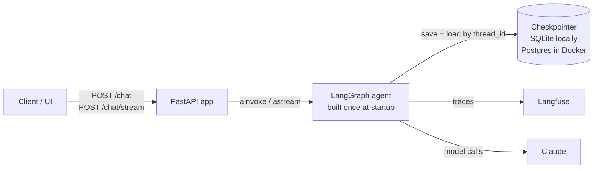

# Block 10 – Serving and durability (60 min)

**Goal:** turn the agent from a script into a service: an HTTP API with streaming answers, memory that
survives restarts, and a container you could deploy.



## What's new compared to blocks 01-09

| Script (blocks 01-09) | Service (block 10) |
|---|---|
| `graph.invoke(...)` once, then exit | `await graph.ainvoke(...)` per HTTP request, server keeps running |
| `InMemorySaver`: memory lost on exit | SQLite file or Postgres: memory survives restarts |
| Build the graph every run | Build the graph **once** at startup (`lifespan`), reuse for every request |
| Print the whole answer at the end | Stream tokens as they're generated (`/chat/stream`) |
| A Python traceback on failure | Clean HTTP errors (422 bad input, 500 runaway agent) |
| `flush()` at the end of the script | `flush()` once at shutdown |

## Steps

**1. Install the new packages**
```bash
.venv/bin/pip install -r requirements.txt
```

**2. Run the server locally (SQLite checkpointer)**
```bash
make serve
```
Open http://localhost:8000/docs: FastAPI generates an interactive page where you can try every endpoint.

**3. Talk to it** (second terminal)
```bash
.venv/bin/python 10-serving/client_demo.py
```
Watch the third answer stream in word by word.

**4. Prove memory is durable**
Stop the server (Ctrl+C), start it again with `make serve`, then:
```bash
curl http://localhost:8000/threads/alice-api-1
```
The conversation is still there. With `InMemorySaver` it would be gone.

**5. Run it the production way: Docker + Postgres**
```bash
cd 10-serving && docker compose up --build
```
`/health` now reports `"checkpointer": "postgres"`. Run `client_demo.py` again, then
`docker compose restart api` and check the thread survives.

## Endpoints

| Method | Path | What it does |
|---|---|---|
| POST | `/chat` | One turn. Returns `answer`, `tools_used`, `messages_in_thread` |
| POST | `/chat/stream` | One turn as Server-Sent Events: `tool_call`, `tool_result`, `token`, `done` |
| GET | `/threads/{id}` | The stored conversation |
| DELETE | `/threads/{id}` | Forget a conversation (right to deletion) |
| GET | `/health` | Liveness + which checkpointer is active |

## What to look at in Langfuse

- Traces tagged `block-10` and `api` or `stream`; sessions grouped by `thread_id`, users by `user_id`.
- A streamed request produces the same trace tree as a normal one: streaming changes delivery, not the work.

## Key ideas

- **Build once, serve many.** The graph and the DB connection are created in `lifespan` at startup. Creating
  them per request wastes time and connections.
- **The service is stateless; the checkpointer holds the state.** Any server instance can continue any thread,
  because the conversation lives in Postgres. That's what lets you run several replicas behind a load balancer.
- **Async all the way.** `ainvoke` / `astream` and async savers let one process serve many requests while each
  waits on Claude.
- **Streaming is about perceived latency.** Total time is the same; users see the first words in about a second
  instead of waiting for the whole answer.
- **Limits per request.** `MAX_STEPS` (recursion limit) and input validation (message length) protect cost and uptime.

## Known gaps (on purpose, for later blocks)

- No authentication: anyone who can reach the API can read any thread. Add auth and check that `user_id` owns the thread.
- Two requests on the same thread at the same time can race. Production systems queue or lock per thread.
- No retries, timeouts or fallback model yet (block 11).

## Interview Q&A

**Q: How do you deploy an agent?**
As a stateless API service (e.g. FastAPI in a container) with conversation state in a durable checkpointer
(Postgres). Build the graph once at startup, use async calls, stream responses, set per-request limits, and
scale horizontally because any replica can resume any thread.

**Q: Why stream responses if the total time is the same?**
Perceived latency. Agents with tool loops and thinking take several seconds; streaming tokens and tool
events shows progress immediately, which matters more to users than total time.

**Q: What breaks when you scale an agent service to several replicas?**
Anything held in process memory (`InMemorySaver`, caches). Move state to a shared store, make tools
idempotent, and handle concurrent requests on the same thread.

## Hands-on interview questions

**Q: Your API forgot everything after a restart. What was the cause?**
An in-memory checkpointer. With SQLite or Postgres the thread survives; the test `test_memory_survives_restart`
proves it by creating a new app on the same database file.

**Q: Why is the graph built in `lifespan` and not inside the `/chat` handler?**
Building it per request re-creates the model client and opens a new database connection every time: slower,
and it exhausts connections under load.

**Q: What does `/chat/stream` send while Claude is calling a tool?**
A `tool_call` event when the model requests the tool, a `tool_result` event when it returns, then `token`
events for the answer and a final `done`.

**Q: A request made the agent loop. What did the client get?**
HTTP 500 with "Agent stopped after N steps without answering" instead of a hung request or a traceback,
because `GraphRecursionError` is caught.

**Q: How do you make sure deleting a thread really removes it?**
`DELETE /threads/{id}` calls the checkpointer's `adelete_thread`; `GET` then returns 404 (covered by a test).

**Q: Two users send messages to the same `thread_id` at once. What could go wrong?**
Both runs load the same checkpoint and write conflicting next states. Fix with a per-thread lock or queue, and
check that the user owns the thread.
