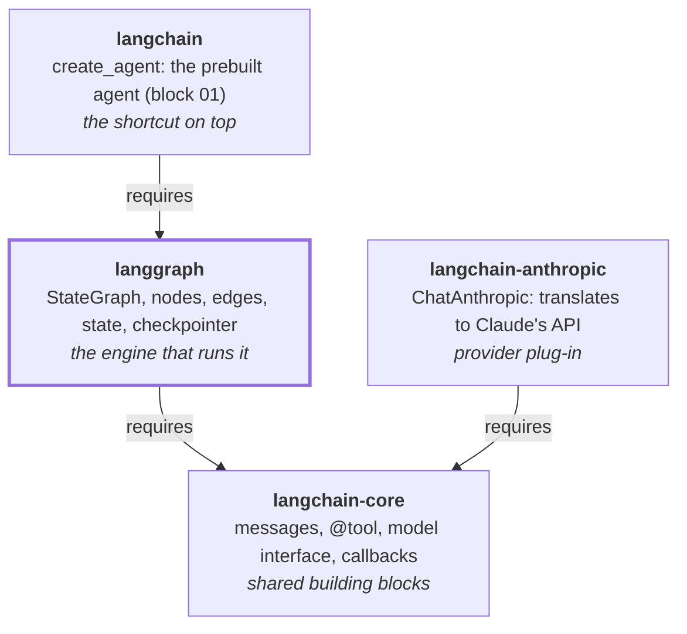
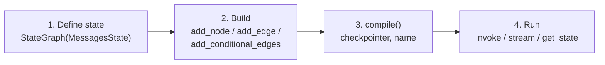
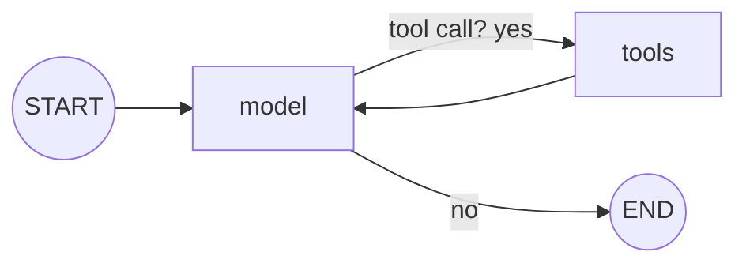
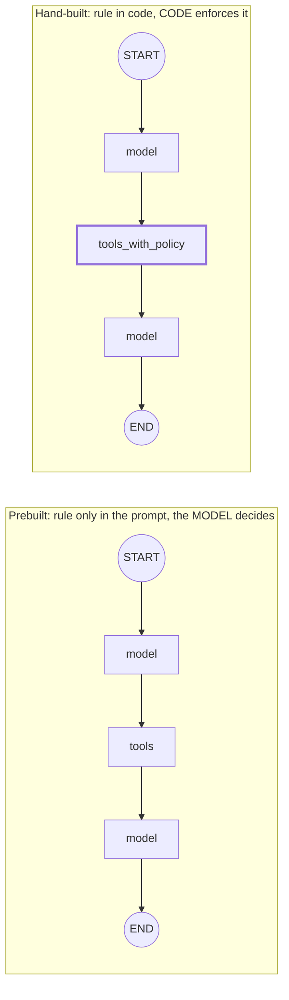
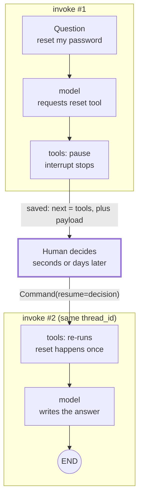
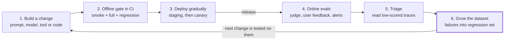
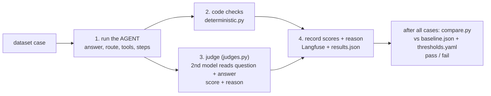

# Agents Weekend – Learning Notes

Concepts, trade-offs and interview Q&A for each block of this repo. Last updated Nov 20, 2026.

## Big picture: Langfuse, one platform, four pillars

Langfuse covers four jobs. The workshop uses all of them except prompt management, which is a planned addition to block 06.

| Pillar | What it means | Where we use it |
| --- | --- | --- |
| **Observability**: trace every step | Every model call, tool call and graph node recorded as a nested trace | Every block, via `langfuse_config()` |
| **Metrics**: cost, latency, tokens | Numbers on each generation, rolled up per trace, user and session | Every trace; compared in block 07 |
| **Evaluation**: score output quality | Datasets, scores, LLM-as-judge, comparing runs | Block 06 (`run_evals.py`) |
| **Prompt management**: version + deploy prompts | Prompts stored in Langfuse with versions and labels; code fetches the current one | Not yet: `SYSTEM_PROMPT` is hard-coded in `common/helpdesk.py` |

**Open source + self-hostable:** enterprises can run Langfuse inside their own network (e.g. on Kubernetes), so prompts and customer data never leave it.

**Why prompt management matters:** a hard-coded prompt means a code change and redeploy for every wording tweak. With prompt management you store the prompt in Langfuse (e.g. `helpdesk-system`, version 3, label `production`), fetch it with `langfuse.get_prompt(...)`, change or roll back in the UI, and see which prompt version produced each trace. Combined with evals: "v2 scored 0.91 vs v1's 0.84 on the eval set, so promote v2 to production."

## Big picture: LangChain vs LangGraph

LangChain gives you the parts; LangGraph runs them as a graph with state. Same company, designed to work together. Every block in this repo runs on LangGraph.

| Library | Its job | Used for |
| --- | --- | --- |
| LangChain | Building blocks | Talking to Claude (`init_chat_model`), messages (`HumanMessage`, `AIMessage`), tools (`@tool`), the `create_agent` shortcut |
| LangGraph | Running the agent | The graph, state, loop, checkpointer, pause/resume |

**Where LangGraph shows up in the code:** `StateGraph` (boxes and arrows), `MessagesState` (the messages list), `ToolNode` / `tools_condition` (the tools box and the "tool call?" arrow), `InMemorySaver` (checkpointer), and `.compile()`, `.invoke()`, `.get_state()`. `create_agent` is imported from `langchain` but builds a LangGraph graph inside. In Langfuse traces, the `model` and `tools` spans are LangGraph steps.



Dependencies run top to bottom: `langchain` requires `langgraph`, and both require `langchain-core`. That's why block 01 ran on LangGraph while importing only `langchain`. Switching to OpenAI swaps only the provider plug-in.

**Short history:** older LangChain (2023-24) had its own agent loop and many abstractions. LangGraph was built to replace it with an explicit, controllable graph. In LangChain 1.0, `create_agent` was rebuilt on LangGraph. Today "LangChain vs LangGraph" means shortcut on top vs engine underneath, not competing tools. LangSmith is the same company's tracing product, an alternative to Langfuse.

## Big picture: LangGraph cheat sheet (StateGraph)

A `StateGraph` works in four phases: define the state, build boxes and arrows, compile, run.



**1. Define the state:** `StateGraph(MessagesState)`. `MessagesState` is a ready-made `messages` list (blocks 02-03); extend it for extra fields, e.g. block 04's `HelpdeskState` adds `route: str`. **Reducers** decide how a node's output merges in: `messages` appends; plain fields like `route` overwrite. So every node returns only what it changed: `{"messages": [reply]}` or `{"route": "kb_agent"}`.

**2. Build** - the four used 90% of the time:

| Method | Plain meaning | Example |
| --- | --- | --- |
| `add_node(name, function)` | Add a box; the function gets the state and returns updates | `g.add_node("model", call_model)` |
| `add_edge(a, b)` | Always go from a to b | `g.add_edge("tools", "model")` (the loop) |
| `add_conditional_edges(a, decide, options)` | After a, call `decide(state)` to pick the next box | `g.add_conditional_edges("router", lambda s: s["route"], [...])` |
| `START` / `END` | Special entry and finish names | `g.add_edge(START, "model")` |

`tools_condition` is a ready-made `decide`: tool calls -> `tools`, otherwise -> `END`. Less common: `add_sequence([a, b, c])` (straight chain), `set_entry_point` / `set_finish_point` (older spellings of START/END edges), `set_conditional_entry_point(decide)`.

**3. Compile:** `graph = g.compile(checkpointer=..., name=...)` turns boxes and arrows into a runnable graph and validates it.

| Option | Purpose | Block |
| --- | --- | --- |
| `checkpointer=` | Save state after every step (memory, resume, pauses) | 03, 05 |
| `name=` | Top span name in Langfuse | all |
| `interrupt_before=[...]` / `interrupt_after=[...]` | Pause before/after a box without code inside it | alternative to 05 |
| `store=` | Long-term memory across threads | stretch |

**4. Run** - methods on the compiled graph:

| Method | What it does |
| --- | --- |
| `invoke(input, config)` | Run to the end, return the final state |
| `stream(input, config, stream_mode=...)` | Yield results step by step: `"updates"` (what each box changed), `"values"` (full state), `"messages"` (LLM tokens for live typing) |
| `ainvoke` / `astream` | Async versions for FastAPI and web servers |
| `batch([...])` | Run several inputs at once |
| `get_state(config)` | Latest snapshot for a thread |
| `get_state_history(config)` | Every snapshot (all checkpoints) |
| `update_state(config, values)` | Edit a saved state, then continue (debugging, time travel) |
| `get_graph().draw_mermaid()` | Draw the graph |

**Special tools a node can use**

| Thing | What it does | Block |
| --- | --- | --- |
| `interrupt(payload)` | Pause inside a node, wait for a human | 05 |
| `Command(resume=...)` | Resume a paused graph with the human's answer | 05 |
| `Command(goto="x", update={...})` | Update state and jump to box x, without a conditional edge | alternative to 04 |
| `Send("node", data)` | Start many parallel copies of a box (map-reduce) | stretch |

**The minimal recipe**

```python
g = StateGraph(MessagesState)                    # 1 state
g.add_node("model", call_model)                  # 2 boxes
g.add_node("tools", ToolNode(tools))
g.add_edge(START, "model")                       #   arrows
g.add_conditional_edges("model", tools_condition)
g.add_edge("tools", "model")
graph = g.compile(checkpointer=InMemorySaver())  # 3 compile
graph.invoke({"messages": [...]}, config)         # 4 run
```

Everything else is a variation: more boxes, more arrows, or a richer state.

**What goes into nodes, and why**

A node is one step of work: a function that receives the state and returns only what it changed. LangGraph runs it, merges the result, saves a checkpoint, and follows the arrows.

| Node type | Job | Calls an LLM? | Repo example |
| --- | --- | --- | --- |
| LLM call | Ask the model to reason or answer | Yes | `model` (02) |
| Tool execution | Run the tools the model asked for | No | `tools` / `ToolNode` (02) |
| Router / classifier | Decide where to go next | Usually, cheap model | `router` (04) |
| Guardrail / validation | Check or clean input or output | Sometimes | `redact_secrets` (code), `input_guardrail` (LLM) (07) |
| Retrieval | Fetch documents or data for context (RAG) | No | KB search before answering |
| Human-in-the-loop | Pause and wait for approval | No | `reset_password` with `interrupt()` (05) |
| Sub-agent | Run a whole agent as one step | Yes, inside | `kb_agent`, `ticket_agent` (04) |
| Deterministic logic | Format, calculate, call an API, apply a policy | No | `tools_with_policy`, `refuse` (07) |
| Merge / aggregate | Combine parallel results | Sometimes | stretch |

Many nodes call no LLM: good agents are often more code than model, because deterministic steps are cheaper, faster, testable and reliable.

**Why split work into nodes:** each node is its own span in Langfuse (visibility); state is checkpointed after each (resume from the last finished step); routing and pausing happen between nodes; each is a small testable function; nodes can be reused, owned by different teams, or run in parallel.

**How big should a node be?** One responsibility, at the level where you'd want to see it in the trace, route on it, or resume from it. Too big hides failures and redoes everything on a crash; too small makes noisy traces.

**Details:** return only changed fields (`{"route": "kb_agent"}` leaves `messages` alone; `{"messages": [reply]}` appends). A node can also return `Command(goto="x", update={...})` to update state and choose the next node itself.


## Big picture: production readiness checklist

Blocks 01-09 cover the core of agent engineering. Production adds serving, durability, reliability and operations; autonomy adds planning and background work. Tick items as the repo gains them.

**Covered**

- [x] Agent loop, tools, tool design (01-02)
- [x] State, checkpointing, short-term memory (03)
- [x] Multi-agent routing (04)
- [x] Human-in-the-loop approvals (05)
- [x] Evals: deterministic checks + LLM judge (06)
- [x] Guardrails, cost, latency (07)
- [x] Framework comparison (08)
- [x] Observability: traces, sessions, cost (all blocks)
- [x] Architecture decisions: ADR guide + 4 ADRs

**Production gaps**

- [ ] Serving: FastAPI, async, streaming responses (block 10)
- [ ] Durable state: Postgres checkpointer (block 10)
- [ ] Containers and scaling: Docker, multiple workers resuming the same threads (block 10)
- [ ] Reliability: timeouts, retries, fallback model, tool error handling (block 11)
- [ ] Prompt management: versioned prompts fetched from Langfuse (block 11)
- [ ] CI/CD with an eval gate: block changes that lower scores (block 12)
- [ ] Online monitoring: alerts on cost, errors, step counts; scoring sampled production traces (block 12)
- [ ] Security: auth, acting on the user's behalf, secrets in a vault, PII masking in traces

**Autonomy gaps** (the repo is reactive: one request, one answer)

- [ ] Planning: break a goal into steps, track progress, re-plan on failure (block 13)
- [ ] Long-running and background work: triggered by events or schedules, survives restarts (block 13)
- [ ] Self-checking / reflection before finishing (block 13)
- [ ] Budgets and stop conditions: limits on steps, time and spend per task (block 13)
- [ ] Long-term memory across conversations
- [ ] Tools via MCP

**Planned blocks**

| Block | Builds | Covers |
| --- | --- | --- |
| 10 - Serving and durability | FastAPI + streaming + durable checkpointer + Docker Compose with Postgres | Serving, durable state, containers |
| 11 - Reliability and prompt management | Retries, timeouts, fallback model; prompts from Langfuse by version | Reliability, prompt management |
| 12 - CI eval gate and monitoring | GitHub Actions running evals, failing on score drops; alert rules | CI/CD, monitoring |
| 13 - Autonomous task agent | Plan -> execute -> check -> re-plan, in the background with a budget, plus long-term memory | Planning, background work, reflection, budgets |

## Block 01: What is an agent?

An agent is the same LLM wrapped in a loop that lets it act. The intelligence comes from the model; the agency comes from your code around it.

```
Layer 1: LLM call   -> one request in, one response out. No memory, no actions.
Layer 2: Chatbot    -> LLM call + conversation history.
Layer 3: Agent      -> LLM + tools + a LOOP: the model decides what to do next,
                       does it, looks at the result, and decides again.
```

**The three ingredients**

| Ingredient | In code | Analogy |
| --- | --- | --- |
| Model | `model=get_llm()` (Claude Sonnet) | The brain: reads and writes text |
| Tools | `tools=[...]` (empty in block 01) | The hands: lets it act on real systems |
| System prompt | `system_prompt=SYSTEM_PROMPT` | The job description, read before every message |

**Key lesson: the model only knows what you send it.** In block 01 the prompt says "use the tools", but no tools are sent. Claude can't see the company's systems, so it honestly says it can't check outages. Your code must give it tools, and your code runs them; the model only asks for them.

**Why use a framework at all?** A single question and answer doesn't need one. Real agents need a loop (block 02), state across steps and turns (03), routing and branching (04), and pause/resume for human approval (05). LangGraph provides those pieces.

**State:** everything an agent knows lives in its state. Here that's just a dict with a `messages` list. After block 01 runs, it holds two messages: the user's and Claude's.

## Block 01: Configuration basics (common/config.py)

`config.py` has one job: hand the rest of the code a Claude model, so no other file deals with keys or model names.

1. **Reads `.env`** with `load_dotenv()`, so keys stay out of the code.
2. **Picks the models** from a lookup table: `_DEFAULTS[PROVIDER]["main"]` gives `claude-sonnet-5-5` (smart, for answers) and `["cheap"]` gives `claude-haiku-5-5` (fast and cheap, for routing and guardrails later). Changing `LLM_PROVIDER` switches to OpenAI without touching code.
3. **Builds the model** with `get_llm()` / `get_cheap_llm()`.

**Configuration over code:** anything that changes between environments or experiments (keys, model names, URLs) lives in `.env`. The commented `MODEL=` / `CHEAP_MODEL=` lines are optional overrides; `os.getenv("MODEL", default)` uses the `.env` value if present, otherwise the default.

**Tokens:** LLMs read and write tokens, not words. 1 token is about 3/4 of an English word, so 1,024 tokens is about 750 words. Cost, speed and limits are all counted in tokens.

**max_tokens:** the ceiling on the reply's length (here 1,024). The reply stops early if it's done, or gets cut off at the limit. It controls cost and speed, and Anthropic's API requires it. With newer Claude models, thinking tokens count toward it too.

**temperature:** how random the next-token choice is. 0 = predictable and repeatable (agents, extraction, evals); high = creative (brainstorming). Newer Claude models reject it entirely because their thinking step handles this, so the code only sends it when explicitly asked.

**`**kwargs`:** builds the model's settings as a dict and spreads it into named arguments, so `temperature` can be included only sometimes.

## Block 01: Tracing basics (Langfuse)

LangGraph fires callback events at every step; Langfuse's `CallbackHandler` listens and turns them into a trace.

```
Trace  (one user request; tags, user_id)
 └─ helpdesk-v1        span: the whole agent run
     └─ model          span: the graph node
         └─ Claude     GENERATION: prompt, response, tokens, cost, latency
```

- **Trace:** one end-to-end request.
- **Span:** one step inside it; spans nest.
- **Generation:** a span for an LLM call, with model, tokens and cost.
- **`trace_attributes(user_id=..., tags=[...])`** stamps that metadata on every span inside the `with` block.

**The three tracing helpers (common/tracing.py)**

| Function | Job | Needed for a trace to exist? | Why it still matters |
| --- | --- | --- | --- |
| `langfuse_config()` | Creates the trace (Langfuse listens via callbacks) | Yes, essential | No callbacks, no trace |
| `flush()` | Delivers the trace before the script exits | No (usually) | Reliability: guarantees delivery in scripts, crashes and serverless |
| `trace_attributes(...)` | Labels the trace (tags, user_id, session_id) | No | Usefulness: without labels, you can't filter, group by user or session, or see per-user cost |

Rule: `langfuse_config` decides *whether* there's a trace; `trace_attributes` only decides *what it's labelled*.

Analogy: `langfuse_config` = the camera is on; `flush` = the footage is saved; `trace_attributes` = the footage has a title and date on it.

Why `flush()` is "usually" optional: the SDK tries to send pending traces automatically when a script exits normally. Traces get lost when that can't run: a crash or kill, or serverless functions frozen right after responding. Calling `flush()` turns "probably delivered" into "definitely delivered".

**flush():** Langfuse sends traces in the background, in batches, so it doesn't slow the app. A short script can exit before the batch goes out. `flush()` means "send everything now". Call it at the end of every script; long-running servers rarely need it.

**Content blocks:** newer Claude models think before answering, so a reply's `.content` is a list of blocks (`thinking` + `text`). Use `.text` to get just the answer. Thinking tokens are still billed, which matters for cost.

## Block 01: Lessons from hands-on experiments

**Reading the Langfuse trace tree** (Tracing -> click a trace; the Observations page is a flat list for searching across traces):

```
helpdesk-v1            5.21s               the agent run (name from create_agent)
 └─ model             5.21s               the graph step (a LangGraph node)
     └─ ChatAnthropic   5.21s   $0.005896   the actual Claude call
```

- **A parent's time includes its children.** Walk down to where the time stops shrinking to find the slow part. Here almost all time is the Claude call.
- **Cost appears only on generations** (LLM calls); other lines are structure.
- **A graph step vs the model call:** `model` is the box (a function LangGraph runs); `ChatAnthropic` is the call made inside it. Some boxes (tools, guardrail code) make no model call at all.
- **Back-of-envelope cost:** $0.006 per question x 1,000 a day x 30 = about $180 a month.

**Double counting: one call traced twice.** The Anthropic SDK (2.11+) has built-in OpenTelemetry tracing. Langfuse also uses OpenTelemetry, so it picked up a second generation (`anthropic.messages...`) for the same call, which can double token and cost totals. Langfuse only shows what code sends; the fix is in `.env`: `ANTHROPIC_OPEN_TELEMETRY=false`. Lesson: instrument at one layer only, and sanity-check totals against provider billing.

**Thinking blocks: empty does not mean no thinking.** The reply's first block was `{'type': 'thinking', 'thinking': '', 'signature': '...'}`. Claude did reason; the API returns only an encrypted signature, not the text. The signature lets the reasoning carry into later turns, so don't strip thinking blocks from history. Hidden thinking tokens are still billed and add latency; compare `output_tokens` in `usage_metadata` with the visible answer length (~chars / 4).

**The system prompt is role + context + rules, not just tone.** Replacing it entirely with "Answer like a pirate" changed far more than the accent: the agent forgot it was Example Corp's IT helpdesk, gave consumer VPN advice, and dropped the rules (short answers, use tools, tickets). To change tone only, add a line instead of replacing. This is why prompts are versioned and tested with evals.

**The flush() experiment.** Without `flush()`, a normal exit still delivered the trace (the SDK sends pending data at exit). With `os._exit(0)` (simulating a crash or kill), the trace is lost unless `flush()` runs first.

| How the script ends | Without flush() | With flush() |
| --- | --- | --- |
| Normal exit | Trace arrives | Trace arrives |
| Abrupt exit (crash, kill, serverless freeze) | Trace lost | Trace arrives |

**Message roles:** `system` (developer's rules, most trusted), `user` (the human), `assistant` (the model's earlier replies), `tool` (results, treated as data, not orders). Roles let the model follow, answer and stay consistent, and they're a defence against prompt injection. Claude's API sends the system prompt as a separate field and tool results inside a user turn; LangChain converts this for you.

## Block 02: Tools and the agent loop

A tool is a normal Python function that Claude is allowed to ask for. Claude never runs it and never sees its code; it only sees a description card.

**The tool card (built by `@tool`)**

| From the function | Becomes on the card | Example (`check_system_status`) |
| --- | --- | --- |
| Function name | Tool name | `check_system_status` |
| Docstring | What it does and when to use it | "Check whether an IT system is up... Use when a user reports something is broken, before creating a ticket." |
| Parameters + type hints | Input schema (JSON Schema) | `{'system': {'type': 'string'}}` |

See any card with: `t.name`, `t.description`, `t.args`.

- **Docstrings are instructions to the model, not comments.** A good description says *what* the tool does and *when* to use it (or what to do first).
- **One sentence changes behaviour.** "Before creating a ticket" makes the agent check for an outage first, instead of opening 200 duplicate tickets when the VPN is down for everyone.
- **Type hints become the contract.** `system: str` becomes `"type": "string"`. Valid values listed only in the description are a hint; `Literal["email", "vpn", ...]` would enforce them in the schema.

**How Claude uses a tool: it asks, your code does**

1. Your code sends Claude the question plus the tool cards.
2. Claude replies with a structured request: "call `check_system_status` with `system='vpn'`".
3. Your code runs the real Python function.
4. Your code sends Claude everything so far plus the tool's result.
5. Claude answers the user using that result.

Steps 2 to 4 can repeat several times before step 5. That repetition is the loop that makes it an agent.

**Watching it happen** (`02-tools/one_question.py`):

```
Step 1  YOU asked:               Is the VPN down right now?
Step 2  CLAUDE asked for a tool: check_system_status({'system': 'vpn'})
Step 3  YOUR CODE sent back:     degraded - EU gateway intermittent, fix ETA 2 hours
Step 4  CLAUDE answered:         Yes, the VPN is currently degraded...
Model calls in this run: 2       (one to decide, one to answer)
```

Nobody wrote "if the question mentions VPN, call check_system_status". Claude chose the tool from the question and the cards.

**Why "Claude asks, code does" is safer: least privilege**

| Because your code runs the tool, it can... | Example |
| --- | --- |
| Ask a human first | Password reset waits for an admin (block 05) |
| Check the request | Reject `create_ticket` for an unknown user |
| Limit what's possible | No delete-user tool means the agent can't delete users, whatever it's asked |
| Record everything | Every request and result appears in the Langfuse trace |

**Prebuilt agent vs building your own graph**

The **standard loop** (the ReAct loop: reason, act, observe, repeat) is the same for almost every agent: ask the model, run any tools it requested, repeat until it answers. Frameworks offer it ready-made.



| | Prebuilt (`create_agent`) | Your own graph (`StateGraph`) |
| --- | --- | --- |
| Code | One line | Five lines: two boxes, three arrows |
| Gives you | The standard loop only | Any boxes and arrows you add |
| Use when | A plain tool-using agent | You need routing, approvals, guardrails, parallel steps |

The five lines (`common/graphs.py`): `add_node("model", ...)`, `add_node("tools", ToolNode(...))`, `add_edge(START, "model")`, `add_conditional_edges("model", tools_condition)`, `add_edge("tools", "model")`. The last arrow is the loop: without it, tool results never reach the model and there is no answer.

Every later block is the standard loop plus one custom box or arrow: memory (03), a router before it (04), a pause inside tools (05), guardrails in front (07).

**Same execution, different builder.** Run side by side, both agents executed `model -> tools -> model` and made identical tool choices. Both are LangGraph `CompiledStateGraph` objects, and both sent `[SystemMessage, HumanMessage]` to Claude first. The differences are in who builds the graph and what you can change:

| | Prebuilt (`create_agent`) | Hand-built (`StateGraph`) |
| --- | --- | --- |
| System prompt | Pass `system_prompt=`; added before every call | You add it in `call_model` |
| tools -> model arrow | Conditional: a tool can end the run early | Always back to the model |
| Adding behaviour | Middleware hooks: before/after model, around each tool call | Your own boxes and arrows anywhere |
| Visibility | Graph hidden unless drawn | Every box and arrow in your code |

**Where they really differ: `02-tools/prebuilt_vs_custom.py`.** Rule: never create a ticket for a system with a known outage, even if the user insists.



With the model forced to request `create_ticket(bob, "3rd floor printer broken")`: prebuilt created INC-1004 (rule broken); the custom `tools_with_policy` box returned "BLOCKED BY POLICY" and created nothing (rule held). Same request from the model, different outcome. Real Claude may refuse in the prebuilt version too, but only *usually*; code holds *always*. Nothing changed except the shape of the graph.

**What production systems use**

| Situation | Typical choice |
| --- | --- |
| One agent, standard tool loop | Prebuilt agent + middleware |
| A business process with fixed steps (route, act, approve, notify) | Custom graph |
| Several agents working together | Custom graph outside, prebuilt agents inside (most common; block 04 is this) |

Decision rule: if the shape of the flow changes (extra steps, branches, parallel work, multiple agents), use a custom graph. If it's the standard loop with extra rules around model or tool calls (approvals, history trimming, retries, fallbacks, the outage rule), prebuilt + middleware can do it in code too.

**Tool groups** (`common/helpdesk.py`): `KB_TOOLS` (knowledge base lookups: `search_kb`, `check_system_status`), `TICKET_TOOLS` (`get_ticket`, `create_ticket`, `lookup_user`), `ALL_TOOLS` = both. Blocks 02-03 give one agent all five; block 04 gives each specialist only its group: fewer cards, better choices, smaller requests, and least privilege (the KB agent cannot create tickets). KB = knowledge base; in real companies, Confluence or ServiceNow articles searched with RAG.

## Block 03: Memory

Block 03 adds **short-term memory**: the agent remembers within one conversation (thread). The LLM API itself is stateless, so "memory" means your code saves the conversation and re-sends it every turn.

**What we saw:** without memory, "What laptop do I have?" in a new run got "what's your username?". With memory, turn 3 answered "MacBook Pro 14" because turn 1 said "I'm alice". Bob's new thread started blank.

**The code: two additions to the block 02 loop**

| Piece | Code | Job |
| --- | --- | --- |
| Checkpointer | `build_tool_agent(..., checkpointer=InMemorySaver())`, attached at `g.compile(checkpointer=...)` | Saves the full state after every step |
| thread_id | `langfuse_config(thread_id="alice-chat-1")` -> `{"configurable": {"thread_id": ...}}` | Names the conversation: same id = same chat window, new id = blank slate |

- **Only the new message is sent** to `invoke`. The checkpointer loads the saved history and appends it.
- **One value, two jobs:** the same string is the `thread_id` (LangGraph loads/saves the conversation) and the `session_id` (Langfuse groups traces in the Sessions view).
- **InMemorySaver** is lost when the script ends. Production uses Postgres, SQLite or Redis savers: same code, different saver.
- **Stored messages (10 for 3 questions):** user questions, Claude's tool requests, tool results and Claude's answers. All of it is re-sent next turn.
- **Checkpoints (11):** a snapshot after every graph step, like save points in a game. They enable resume after a crash, pause for approval (block 05), and inspecting any step. `graph.get_state(...)` = latest snapshot; `graph.get_state_history(...)` = all of them.
- **Hidden cost:** 3 short questions used ~12k tokens and $0.03, because the system prompt, tool cards and growing history are re-sent each turn.

**Bonus observations**

- **Parallel tool calls:** Claude asked for 3 tools in one step (status, KB, user lookup), so the whole run took only 2 model calls.
- **Docstrings shape behaviour:** "I haven't opened a ticket because the outage already explains the drops" came from "before creating a ticket" in the tool description.

**Reading the Langfuse Sessions page:** the header shows totals for the conversation (traces = turns, time, cost, tokens, user). Left panel = one card per turn. Right panel = the chat. For per-turn tokens, use the Tracing page. Never click "Make Public" on real conversations.

## Kinds of memory in agents

The code in this repo is **short-term memory only**. Long-term memory (LangGraph's Store) is a stretch exercise.

| | Short-term | Long-term |
| --- | --- | --- |
| Scope | One conversation (thread) | Across all conversations |
| Lasts | Until the chat ends | Days, months, forever |
| Example | "it" = the VPN from 2 messages ago | "alice prefers Slack", learned last week |
| In LangGraph | Checkpointer + `thread_id` | Store: key-value database by namespace, e.g. `("users", "alice")` |
| How the model sees it | Whole history re-sent each turn | Code looks up relevant facts and adds them to the prompt |

**Three kinds of long-term memory**

| Kind | Human analogy | Agent example |
| --- | --- | --- |
| Semantic (facts) | "Paris is in France" | alice is in Finance, has a MacBook, prefers Slack |
| Episodic (experiences) | "Last time X worked" | Last month alice's VPN issue was fixed by switching gateway |
| Procedural (how-to) | Riding a bike | System prompt, tool descriptions, learned rules (links to prompt management) |

**Where memory lives:** in the context window (fast, simple, costs tokens every call, size-limited) or in external storage (database, vector store; unlimited but needs a retrieval step). RAG is long-term semantic memory over documents.

**Managing short-term memory as it grows:** trim to the last N messages; summarise old turns; promote lasting facts to long-term memory and drop them from history.

**What is sent on every call** (seen with `03-memory/watch_messages.py`): each Claude call carries the system prompt + all tool cards (neither is stored in `messages`) + the whole history so far. Tool *results* are stored in `messages` and sent from the call after they were produced. So every call has a fixed overhead plus a growing history; prompt caching targets the fixed part. In the real run, Claude fetched alice's profile in turn 1, so turn 3 answered from history without a tool call.

## Memory: decisions to make and capabilities to build

The block 03 code is short-term memory only. These are the decisions a production agent needs, each a candidate ADR.

**Short-term memory decisions**

| Decision | Options | What to weigh |
| --- | --- | --- |
| Where state lives | In-memory, SQLite, Postgres, Redis | Survive restarts? Pauses lasting hours? Multiple pods? |
| What a thread is | Per chat window, per ticket, per user per day | When should context reset? Mixing topics confuses the model |
| Context growth | Keep all, trim to last N, summarise old turns, drop old tool results | Cost per turn vs losing details the user refers back to |
| Retention | Hours, days, until ticket closes | Privacy, storage cost, audit needs |

**Long-term memory decisions**

| Decision | Options | What to weigh |
| --- | --- | --- |
| What to remember | Facts (semantic), past episodes, learned rules (procedural) | Only what changes future answers |
| Who writes it | Agent automatically, on user request, or a background job after each conversation | Automatic is convenient but stores wrong or sensitive things |
| Scope | Per user, per team, global | Never leak one user's facts into another's answers |
| Retrieval | Key lookup by user ID, semantic search, both | Accuracy vs cost and latency per request |
| Conflicts and staleness | Newest wins, timestamps, expiry | "Laptop: MacBook" may be outdated next year |
| Privacy | What's never stored, user can view and delete | Right to deletion; no secrets, health or financial data |

**Capabilities to build next (in order)**

- [ ] **Durable short-term memory:** swap `InMemorySaver` for `SqliteSaver`; restart the script and continue the same thread.
- [ ] **History trimming:** keep the last N messages; measure input tokens before and after in Langfuse.
- [ ] **Summarisation:** when history passes a size limit, replace old turns with a summary message.
- [ ] **Long-term user facts:** a LangGraph Store keyed `("users", "<name>")`; a new thread for alice still knows her laptop.
- [ ] **Memory write policy:** decide in code what may be saved (allow-list of fact types; block secrets).
- [ ] **Memory evals:** test cases that need earlier turns ("what did I say my name was?") and cases where old facts must not leak across users.
- [ ] **Forget:** a way to delete a thread (`delete_thread`) and a user's stored facts.

Interview angle: "Short-term memory is a checkpointer plus a context-growth strategy. Long-term memory is a product decision: what to remember, who writes it, how it's retrieved, and how users delete it."

## Block 04: Multi-agent

One agent with every tool works for 5 tools, not 40. Block 04 replaces it with a team: a front desk that routes, and specialists that answer.

**Why one big agent breaks down at scale**

| Problem | Why |
| --- | --- |
| Wrong tool choices | Many similar tool cards to choose from |
| Higher cost | Every request carries all the tool cards |
| One giant prompt | It has to describe every job at once |
| Hard to own | Different teams (IT, HR) edit the same agent |

**The fix: a router and specialists**

```
                        +--> kb_agent      (search_kb, check_system_status)
user --> router --------+--> ticket_agent  (get_ticket, create_ticket, lookup_user)
      (front desk)      +--> general       (no tools: greetings, off-topic)
```

- **Router:** reads the question and only decides who handles it. It never answers.
- **Specialists:** each is the same block 02 loop, with fewer tools and a focused prompt.
- **Result:** each specialist does one job well; the router's only job is picking the right one.

## Block 05: Human-in-the-loop

The agent may propose a risky action, but code makes it wait for a human. One run becomes two `invoke` calls: the first ends in a pause, the second resumes it, possibly days later.

**The six components** (`05-human-in-the-loop/solution.py`)

| # | Component | In the code | Job | Without it |
| --- | --- | --- | --- | --- |
| 1 | `interrupt(payload)` in the risky tool | `reset_password` | Stops at the exact point approval is needed; hands the human what/who/why | The action runs with no approval |
| 2 | Checkpointer | `checkpointer=InMemorySaver()` | Saves the paused state | Resume fails: `Cannot use Command(resume=...) without checkpointer` |
| 3 | `thread_id` | `langfuse_config(thread_id=...)` | Names the paused run so the resume finds it | Resume can't find the state |
| 4 | Pause detection | `while "__interrupt__" in result` | Notices the stop, reads the payload | A paused run looks finished |
| 5 | Approver | `ask_human(payload)` | Shows the payload, returns `{"approved": ...}` | No decision to resume with |
| 6 | `Command(resume=decision)` | `graph.invoke(Command(resume=...), config)` | Continues the run; `interrupt()` returns the decision | Run stays paused forever |

To remember: the tool pauses (1), the checkpointer saves (2) under a thread_id (3); the caller notices (4), asks a human (5), and resumes (6).



The model is not called again on resume: the run continues at the saved `next = tools` and re-runs that box.

**The flow of both invoke calls** for "I'm bob, please reset my password":

| Step | Call | Box | What happens | Saved? |
| --- | --- | --- | --- | --- |
| 1 | invoke #1 | (load) | New thread; state = the question | |
| 2 | | model | Claude call #1 asks for `reset_password(bob)` | Yes |
| 3 | | tools | `interrupt()` stops the node; nothing is reset | Yes, `next = ("tools",)` + payload |
| 4 | | - | `invoke` returns early with `__interrupt__` and the payload; no answer yet | |
| - | (human) | - | Admin decides `{"approved": True}`: seconds or days | |
| 5 | invoke #2 | (load) | Same thread_id; resumes at `next = tools`, skipping the model | |
| 6 | | tools | Tool re-runs from the top; `interrupt()` now returns the decision; reset happens once | Yes |
| 7 | | model | Claude call #2 writes the answer from the tool result | Yes |
| 8 | | - | Final state: Human, AI(tool call), Tool(reset done), AI(answer) | |

**Counts:** 2 invokes, 2 Claude calls (the resume adds none), and the tools box runs twice. If Claude first calls `lookup_user`, that adds one more model -> tools round before step 3. A denial changes only step 6: the tool returns "DENIED by admin", and Claude explains it in step 7.

**Rules that matter**

- **The node re-runs on resume.** Code before `interrupt()` runs twice (verified: a counter went 1 -> 2). Put side effects (emails, API calls, the action itself) after the interrupt.
- **Checkpointer + same thread_id are required** for resume. The pause can even appear to work without a checkpointer; the resume is what fails.
- **Approval is enforced in code, not the prompt.** The prompt never says "ask first"; the tool simply can't act without a human answer.
- **A denial is just data** to the model: a tool result it explains to the user.

**Demo vs production:** components 1-4 stay the same. The checkpointer becomes Postgres (block 10). The approver becomes Slack buttons or a web UI, and the resume becomes a webhook or API endpoint that calls `Command(resume=...)` with the stored thread_id, possibly hours later on a different server.

Watch it in `notebooks/05-human-in-the-loop.ipynb`: cell 2 is invoke #1 (`paused? True`, `will continue at: ('tools',)`), cell 3 is invoke #2.

## Block 06: Evals

An eval is a fixed set of questions with expected outcomes, plus scorers, run on every change. Evals are the unit tests of agent behaviour: they catch "the code works, but the agent got worse".

### Evals essentials

**1. Offline vs online**

| | Offline evals | Online evals |
| --- | --- | --- |
| When | Before release: every PR, merge, nightly | After release, on live traffic |
| Data | A fixed dataset you wrote (+ past failures) | Real user requests, often a 5-20% sample |
| Expected answer known? | Yes: route, tools, facts to mention | No: only the question and the answer |
| Scorers | Code checks + LLM judge | LLM judge + user feedback (thumbs up/down) + ops metrics |
| Answers the question | "Is this change safe to ship?" | "How is it doing for real users right now?" |
| Catches | Regressions from prompt, model or code changes | New kinds of questions, drift, failures the dataset missed |
| In this repo | `06-evals/run_evals.py` | `10-serving`: `chat-turn` + Langfuse judge rule + `/feedback` |

They feed each other: online failures become new offline test cases.

**2. Kinds of evals**

By what is measured:

| Kind | Question it answers | Example |
| --- | --- | --- |
| Final answer | Is the answer correct and helpful? | `mentions`, `helpfulness` |
| Trajectory | Did it take the right path? | `route_correct`, `tool_correct`, step count |
| Single step | Is one component right? | Router accuracy alone; one tool's output |
| Safety | Did it avoid what must never happen? | `forbidden_tools`, `no_pii_leak`, prompt-injection cases |
| Operational | Is it affordable and fast? | Cost per request, p95 latency, error rate |
| Regression | Did old bugs stay fixed? | `regressions.jsonl` |

By who or what scores:

| Method | Strength | Weakness |
| --- | --- | --- |
| Code checks | Free, fast, exact | Only for things code can verify |
| LLM judge | Scores nuance (helpfulness, tone) at scale | Biased, inconsistent; needs calibration |
| Human review | Ground truth | Slow and expensive; used to calibrate judges |
| User feedback | Real satisfaction signal | Sparse, noisy, only after release |

**3. Production workflow**



1. **Build** a change: prompt, model, tool or code.
2. **Offline gate in CI:** unit tests + smoke evals on the PR; full + regression evals on main; fail if below floor or worse than baseline.
3. **Deploy gradually:** staging -> smoke evals on the deployed service -> canary (small % of traffic).
4. **Online evals:** judge on sampled live traffic + user feedback + cost/latency/error dashboards and alerts.
5. **Triage:** review low-scored and thumbs-down traces; decide if the agent or the judge is wrong.
6. **Grow the dataset:** add real failures to the regression set, fix, and start again at step 1.

Nightly offline runs catch model or provider drift even when no code changed.

**Two-minute teaching sheet**

1. **Why:** agents are non-deterministic; a prompt tweak can silently break things. "It looked fine when I tried it" doesn't scale.
2. **Measure three things:** the answer (right facts, helpful), the path (route, tools, step count), ops (cost, latency, errors).
3. **Code checks first** (`route_correct`, `tool_correct`, `mentions`): free, fast, exact. **LLM judges second**, only for what code can't check; they can be biased, so read their reasons.
4. **The loop:** change -> run evals -> compare to baseline -> keep or revert.
5. **Offline vs online:** a test dataset before release (block 06); live traffic scored by a judge plus users' thumbs up/down after release (block 10). Production failures get added to the dataset.
6. **Practical rules:** thresholds, not exact matches; trust trends, not one run; start with 20-50 items and grow from real failures.

One sentence: code checks first, LLM judges second, compare every change to a baseline, and turn every production failure into a test.

**Our baseline run**

| Score | Result | Meaning |
| --- | --- | --- |
| `route_correct` | 1.000 | All 16 questions went to the expected specialist |
| `tool_correct` | 1.000 | Each specialist called the expected tool |
| `mentions` | 1.000 | Every answer contained the required facts |
| `helpfulness` | 3.625 / 5 | The judge finds answers OK but not great |

Perfect scores mean the dataset is too easy: it can't catch regressions. Add ambiguous ("my laptop is slow"), two-part, typo, policy-edge and unknown-data cases. The only real signal is helpfulness, so read the judge's reasons on the lowest items and decide whether the agent or the judge is wrong.

**Evals vs unit tests**

| | Unit tests (`tests/`) | Evals (`06-evals/`) |
| --- | --- | --- |
| Checks | Wiring: routes, loop, interrupt, API | Behaviour and quality: routing, tool choice, answers |
| Model | Fake: free, deterministic | Real: costs money, varies run to run |
| Outcome | Pass / fail, exact | Scores against thresholds |
| Flakiness | A bug | Expected; judge by averages and trends |

Pyramid: many fast unit tests at the bottom, offline evals in the middle, a few online evals on sampled production traffic at the top.

**How the judge fits into the flow** (per test case):



The judge only reads the question and answer, like a teacher grading a paper; it never re-runs the agent. Each case costs an agent call plus a judge call, so judges use a cheap pinned model and PRs run a small smoke set. Optional saver: skip the judge when code checks already failed. The same judge prompt serves offline evals, online evals in Langfuse, and calibration against ~30 human-labelled examples.

**A production `evals/` folder**

| File | Holds | Sample |
| --- | --- | --- |
| `datasets/smoke.jsonl` | ~20 cases, every PR; one JSON object per line | `{"id": "tkt-status", "input": "What's the status of INC-1001?", "expected": {"route": "ticket_agent", "tools": ["get_ticket"], "must_mention": ["In Progress"]}}` |
| `datasets/full.jsonl` | 200+ cases incl. typos, multi-turn, two-part | same format, input can be a message list |
| `datasets/regressions.jsonl` | Real production failures, never deleted | adds `source_trace`, `found_by`, `added` |
| `evaluators/deterministic.py` | Small functions: case in, score out | `route_correct`, `tools_called`, `forbidden_tools`, `mentions`, `no_pii_leak`, `step_count` |
| `evaluators/judges.py` | Judge prompts, rubrics, structured score, pinned judge model | 5 = specific and actionable, 3 = vague, 1 = wrong; refusing off-topic = 5 |
| `thresholds.yaml` | Floor (`min`) and allowed drop vs baseline (`max_drop`) per metric | `route_correct: {min: 0.95, max_drop: 0.00}`; safety metrics `min: 1.00` |
| `baseline.json` | Last accepted scores from main, plus model and prompt version | written after a successful main run |
| `run_evals.py` | Load dataset -> run agent -> apply evaluators -> upload to Langfuse -> results.json | `--dataset smoke --run-name pr-142` |
| `compare.py` | The gate: fail if below `min` or dropped more than `max_drop`; prints the PR table | exit code 1 blocks the merge |

**CI/CD pipelines**

| Pipeline | Trigger | Runs | Blocks on |
| --- | --- | --- | --- |
| `pr.yml` | Every PR | Lint, unit tests, smoke evals, compare, PR comment | Unit test failure or score below threshold |
| `main.yml` | Merge to main | Full + regression evals, update baseline, build image | Drop vs baseline beyond tolerance |
| `nightly.yml` | Schedule | Full evals (catches model drift with no code change) + score yesterday's production sample | Alerts only |
| `deploy.yml` | Release | Staging -> smoke evals on the deployed service -> canary -> watch online scores -> full rollout | Online scores or errors worse than current version |

Principles: two test layers (fake-model tests for wiring, real-model evals for behaviour); tiered datasets with a regression set that only grows; pass means "not worse than before"; prompt and model changes go through the same gate as code; eval cost is budgeted.

**Our repo today:** `06-evals/` has the dataset, code checks, judge and runner. Missing (block 12): `thresholds.yaml`, `baseline.json`, `compare.py`, `regressions.jsonl` and the GitHub Actions workflows.

**Online evaluation (block 10):** each `/chat` turn creates a `chat-turn` observation (input = question, output = answer) and returns a `trace_id`; `POST /feedback` stores thumbs up/down as a `user_feedback` score. In Langfuse: add an LLM Connection, create an evaluator (helpfulness rubric), attach a rule on live observations named `chat-turn`, then run `10-serving/live_traffic.py`. Compare where judge and users disagree; the judge's own calls are traced under the environment `langfuse-llm-as-a-judge`.

## Interview Q&A so far

**Q: What's the difference between an LLM call and an agent?**
An LLM call is one request and one response. An agent wraps the model in a loop: it can decide to call tools, observe the results, and continue until it decides it's done.

**Q: Why does an agent need tools if the prompt already tells it what to do?**
The model only knows its training data and what's in the request. A prompt can't give it access to live systems; tools can. The model requests a tool call, and your code executes it.

**Q: What does temperature do?**
It controls randomness when sampling the next token. Low is deterministic, which suits agents, extraction and evals; high is more varied, for brainstorming. Some newer reasoning models don't expose it and manage sampling internally.

**Q: What is max_tokens and why set it?**
The maximum length of the reply in tokens. It caps cost and latency per call. With reasoning models it also has to leave room for thinking tokens.

**Q: Why do you need observability for LLM apps when you already have logs?**
Logs show that a request happened. A trace shows the full chain: the exact prompt, each model call, tool inputs and outputs, tokens, cost and latency per step. That's what you need to debug non-deterministic behaviour.

**Q: Trace vs span vs generation?**
A trace is one end-to-end request. Spans are the nested steps inside it. A generation is a span for an LLM call, with model, prompt, completion, tokens and cost.

**Q: How does an LLM "call" a tool?**
It doesn't run anything. The tool's name, description and input schema are sent with the request. The model replies with a structured tool call (name + arguments). The application runs the function, sends back the result, and calls the model again.

**Q: Why is it safer that the model only requests tool calls?**
Your code sits in the middle. It can validate the request, require human approval, refuse it, and log it. And the agent can only do what its tools allow: least privilege.

**Q: The agent keeps picking the wrong tool. What do you check first?**
The tool cards: names, descriptions and input schemas, as seen in the trace. Most wrong-tool bugs are vague or overlapping descriptions, or missing "when to use" guidance.

**Q: How do you persist agent state in production?**
A checkpointer backed by a durable store (usually Postgres; Redis for speed), keyed by thread ID. Every step is saved, so a crashed run can resume and a paused run can continue hours later on a different pod.

**Q: How would you give an agent memory?**
Two layers. Short-term: thread-scoped state persisted by a checkpointer, with trimming or summarisation to control context size. Long-term: a separate store for user facts, past episodes and learned procedures, retrieved into the prompt when relevant. The hard parts are deciding what's worth remembering, retrieving the right thing, and privacy: users must be able to see and delete what's remembered.

**Q: The context window keeps growing. What do you do?**
Trim old messages, summarise earlier turns, keep tool outputs short, and move lasting facts into long-term memory. Watch input tokens per turn in traces to know when it matters.

**Q: How do LangChain and LangGraph relate?**
langchain-core provides the shared abstractions: messages, tools, model interface, callbacks. LangGraph is the stateful runtime built on them. LangChain's `create_agent` is a prebuilt agent on LangGraph. I use the prebuilt agent for standard loops and drop to LangGraph when I need custom flow, checkpointing or human-in-the-loop.

**Q: Your traces show double the expected cost. What do you check?**
Whether the same call is instrumented twice, e.g. by the framework's callback and by the provider SDK's own OpenTelemetry tracing. Instrument at one layer and reconcile totals with the provider's billing.

**Q: Prebuilt agent or custom graph in production?**
I start with the prebuilt agent and add middleware for policies like approvals and history trimming. I move to a custom graph when the topology changes: routing, multi-agent, parallel branches, or explicit workflow steps. In practice it's usually a custom orchestration graph with standard agents as nodes.

**Q: A business rule must never be broken. Prompt or code?**
Code. A prompt rule holds usually; the model decides. Enforce it where the model can't bypass it: in the tool, a custom tools box, or middleware around the tool call.

**Q: Are evals the same as unit tests?**
They play the same role for behaviour: a fixed set of cases run on every change, blocking releases that regress. But they produce scores, not pass/fail; the agent is non-deterministic, so you use thresholds and trends; and an LLM judge can itself be wrong. Unit tests with a fake model still cover the wiring.

**Q: How do you gate a prompt or model change in CI?**
Smoke evals on every PR, compared against a baseline from main with per-metric floors and allowed drops (zero tolerance for safety metrics). Full and regression evals on main and nightly. Prompts and model versions are versioned like code and go through the same gate.

**Q: Your eval scores are all 1.0. Good news?**
Usually the dataset is too easy. Add ambiguous, multi-part, adversarial and real-failure cases until some fail; a dataset nothing fails can't catch regressions.
