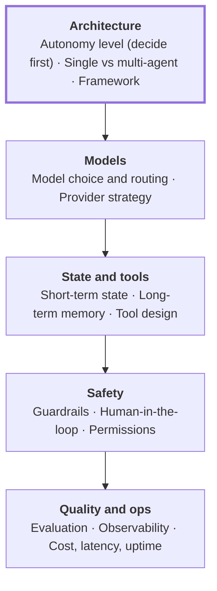
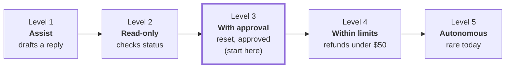
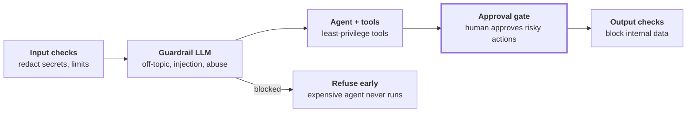

# Architecture Decision Records for agent systems

What to decide when building an agent system, how to decide it, and how to record why.

| ADR | Decision | Status |
| --- | --- | --- |
| [ADR-001](0001-langgraph-for-orchestration.md) | Use LangGraph for orchestration | Accepted |
| [ADR-002](0002-router-and-specialists.md) | Router + specialists, with a cheap routing model | Accepted |
| [ADR-003](0003-human-approval-for-password-resets.md) | Human approval for password resets | Accepted |
| [ADR-004](0004-langfuse-for-observability.md) | Langfuse for observability and evals | Accepted |

New ADRs: copy [template.md](template.md), number it, never edit an accepted ADR (supersede it with a new one).

## What an ADR is and why agents need them

An Architecture Decision Record is a one-to-two page note capturing one significant decision: the context, the options considered, what was chosen, and the consequences.

Why agent systems need them more than most:
- **The field moves fast.** Six months later, nobody remembers why you picked LangGraph or Haiku for routing unless it's written down.
- **Decisions are trade-offs.** Autonomy vs control, cost vs quality, latency vs safety.
- **Behaviour depends on non-code choices.** Prompts, tool descriptions, model versions and eval thresholds matter as much as code.
- **Risk is real.** Agents take actions; reviewers and auditors need to see how risky actions are controlled.

Write an ADR when a decision is expensive to reverse, affects safety/cost/compliance, was debated, or sets a standard others will follow. Skip it for small reversible choices like prompt wording.

## The decision map

Read top to bottom: the autonomy level sets how strict every layer below it must be.

| Layer | Decision | The question to answer |
| --- | --- | --- |
| Architecture | Autonomy level | How much may the agent do without a human? |
| Architecture | Single vs multi-agent | One agent with many tools, or a router and specialists? |
| Architecture | Orchestration framework | LangGraph, Agents SDK, CrewAI, a cloud agent service, or custom? |
| Models | Model choice and routing | Which model for which step? Cheap for routing, strong for reasoning? |
| Models | Provider strategy | One provider, or abstracted to allow switching? |
| State | Short-term state | Where are conversations and checkpoints stored? |
| State | Long-term memory | What is remembered across conversations, and who can delete it? |
| Tools | Tool design and integration | Function tools, MCP servers, or APIs? How granular? |
| Safety | Guardrails | What is checked before and after the model? |
| Safety | Human-in-the-loop | Which actions need approval, and how is approval delivered? |
| Safety | Permissions | Whose identity and rights do tools act with? |
| Quality | Evaluation | How is quality measured before and after release? |
| Quality | Observability | What is traced, where, and what is masked? |
| Operations | Cost, latency, reliability, deployment | Budgets, timeouts, retries, fallbacks, hosting |

## Architecture

**Autonomy level.** Decide this first: it drives safety, approvals and evals.

Each step up removes a human check, so it needs stronger guardrails, evals and limits first.

| Level | The agent... | Example |
| --- | --- | --- |
| 1. Assist | Suggests; a human does everything | Drafts a reply |
| 2. Act on read-only | Looks things up on its own | Checks system status |
| 3. Act with approval | Proposes write actions; a human approves | Password reset after admin approval |
| 4. Act within limits | Acts alone inside hard limits | Refunds under $50, max 3 per user per day |
| 5. Fully autonomous | Acts alone, reviewed afterwards | Rare in enterprises today |

Consider the worst-case action, reversibility, accountability and regulation. Start at level 3; move individual actions to level 4 once evals and traces show they're reliable.

**Single vs multi-agent.** One agent until it measurably struggles (often beyond ~10-15 tools). Router + specialists for distinct domains with different prompts, models or permissions. Supervisor (agents as tools) when one request often needs several specialists combined.

**Framework.** LangGraph for explicit graphs, checkpointing and durable pauses; Agents SDK for minimal tool + handoff agents; CrewAI for fast prototypes; cloud agent services for managed hosting (with lock-in); custom for full control. Keep tools, prompts and evals framework-independent.

## Models

| Step | Typical choice | Why |
| --- | --- | --- |
| Routing, classification, guardrails | Small, fast model | Easy task, runs on every request |
| Reasoning, tool use, answers | Strong model | Quality matters most |
| Hard planning or analysis | Strongest model, sparingly | Only where evals prove the gain |
| LLM-as-judge | A different model from the one judged | Reduces self-preference bias |

Choose by your own eval results, not public benchmarks. Weigh cost, latency, tool-calling reliability, thinking-token cost and data residency. Pin versions and re-run evals before upgrading. For providers: single (simplest), abstraction layer (switch by config), or multi-provider fallback (survives outages, doubles evals).

## State, memory and tools

**Checkpointing:** in-memory for demos and tests, SQLite for single machines, Postgres as the production default, Redis for high-throughput short-lived threads. Consider pauses lasting hours, multi-pod scaling, retention, encryption, and capping context growth.

**Long-term memory:** decide what kinds to keep (facts, episodes, procedures), who writes them, how they're retrieved, and how users see and delete them. Start without it; add when there's a clear need.

**Tools:** small single-purpose tools; MCP when shared across agents or teams; typed inputs and short structured outputs; separate read and write tools; idempotent writes; return clear errors; review tool descriptions like code.

## Safety

Controls must live in code the model can't bypass. A prompt saying "always ask first" is guidance, not enforcement.

| Where | Code checks (fast, certain) | Model checks (flexible) |
| --- | --- | --- |
| Before the model | Redact secrets/PII, length limits | Off-topic, prompt injection, abuse |
| Around tools | Validate arguments, allow-lists, rate limits | Rarely needed |
| After the model | Block internal data, validate format | Policy or tone checks |

**Human-in-the-loop:** approval for irreversible, costly or sensitive actions; decide approver, channel, timeout behaviour and audit trail. Implement with a durable pause (`interrupt()` + checkpointer); code before the pause must be safe to run twice.

**Prompt injection:** treat all external text as data; keep secrets out of reach; least-privilege tools; approvals; output checks; monitor traces.

**Permissions:** agent service account (simple, may over-see) vs acting on behalf of the user (sees only what the user can, more complex auth). Audit every action with the requesting user.

## Quality and operations

**Evaluation:** measure the final answer (deterministic checks, then LLM-as-judge), the trajectory (route, tools, steps) and operations (cost, latency, errors). Start with 20-50 cases, add real failures, gate releases on thresholds, and score sampled production traces.

**Observability:** prefer OpenTelemetry-based tooling; mask PII before export or self-host; decide sampling, retention and alerts (error rate, cost spikes, unusual step counts).

| Concern | Decisions to record |
| --- | --- |
| Cost | Budget per request/month; model routing; prompt caching; context trimming; spend alerts |
| Latency | p95 target; streaming; parallel tool calls; fewer model calls |
| Reliability | Timeouts; retries with backoff; fallback model; max steps; idempotent tools |

**Deployment and data:** hosting (Kubernetes, serverless, managed service), resume endpoints for paused runs, secrets management, data residency and vendor terms. Serverless kills long runs, so use a durable checkpointer and flush telemetry. Version and deploy prompts and model versions like code.

## Using ADRs in interviews

- **Answer shape:** "The key decision is X. Options are A, B, C. I'd pick B because of [constraint]. The trade-off is [cost]. I'd revisit if [trigger]."
- **Lead with autonomy and risk:** "What's the worst action this agent can take?"
- **Tie decisions to measurement:** "I'd only split into multiple agents if routing accuracy stayed above 95%."
- **Practise:** for each prompt in `09-mock-interview/README.md`, write the three ADRs you'd need first.
